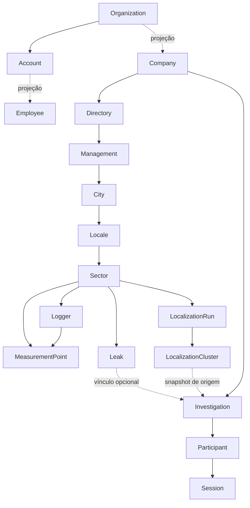

# Catálogo HydroVision

Gerado por `python skills/collection.py sync`; edite as fontes em `skills/_shared`.

## Relações principais

As relações de projeção não autorizam juntar IDs do Accounts e do Vision por igualdade.

## Objetos e conceitos

| Nome canônico | ID | Modelo | Acesso MCP | Significado |
|---|---|---|---|---|
| Organização | `organization` | `accounts.Organization` | Indisponível | Identidade organizacional mestre do ecossistema. |
| Conta | `account` | `accounts.Account` | Indisponível | Pessoa autenticável pertencente a uma organização. |
| Assinatura do produto | `subscription` | `accounts.ProductSubscription` | Indisponível | Assinatura e plano de uma organização para um produto; não é faturamento de pontos. |
| Concessão de acesso | `grant` | `accounts.ProductGrant` | Indisponível | Permissão de uso de um produto por uma conta, dependente de assinatura ativa. |
| Usuário administrativo do Accounts | `service-user` | `users.ServiceUser` | Indisponível | Operador do admin do serviço, distinto de Account e Employee. |
| Empresa | `company` | `company.Company` | Parcial | Projeção da organização usada para recortar dados operacionais. |
| Funcionário | `employee` | `employee.Employee` | Parcial | Projeção operacional da conta. Vínculo company difere da seleção company_scope. |
| Diretoria | `directory` | `company.Directory` | Parcial | Nível territorial imediatamente abaixo da empresa. |
| Gerência | `management` | `company.Management` | Parcial | Nível territorial abaixo de diretoria; não confundir com visão gerencial. |
| Município | `city` | `company.City` | Parcial | Nível territorial abaixo de gerência. |
| Localidade | `locale` | `company.Locale` | Parcial | Nível territorial abaixo de município e acima de setor. |
| Setor | `sector` | `company.Sector` | Parcial | Pivô geográfico dos ativos e vazamentos, com comprimento de rede materializado. |
| Rede de distribuição | `pipe-network` | `pipe.SectorPipeNetwork` | Indisponível | Geometria materializada da rede; não pode ser deduzida de distâncias GPS. |
| Ponto de medição | `measurement-point` | `logger.MeasurementPoint` | Parcial | Local físico onde um equipamento é instalado, independente da identidade do logger. |
| Logger | `logger` | `logger.Logger` | Parcial | Equipamento identificado por MAC; não é seu ponto físico nem uma amostra de telemetria. |
| Instalação do logger | `logger-placement` | `logger.LoggerMeasurementPointPlacement` | Indisponível | Registro de alocação de equipamento em ponto; não reconstruído pelo inventário atual. |
| Foto de instalação | `logger-image` | `logger.LoggerImage` | Parcial | Evidência fotográfica de instalação disponibilizada como prévia JPEG. |
| Amostra acústica do logger | `audio-sample` | `logger.AudioData` | Parcial | Telemetria acústica; não é gravação de campo HydroSense. |
| Amostra de pressão | `pressure-sample` | `logger.PressureData` | Parcial | Telemetria de pressão, em bar nos campos pressure_bar; não leitura manual em mca. |
| Resultado de teste funcional | `functional-test` | `logger.TestResult` | Parcial | Resultado de teste. Saúde considera o batch mais recente, não união de falhas históricas. |
| Snapshot de desempenho | `performance-snapshot` | `logger.LoggerPerformanceSnapshot` | Parcial | Indicadores persistidos; ausência ou idade não certifica saúde/defeito. |
| Alerta acústico | `acoustic-alert` | `logger.LoggerAudioAlertStatus` | Parcial | Indício acústico atual; não equivale a vazamento confirmado. |
| Vazamento | `leak` | `processing.Leak` | Parcial | Caso único vinculado a setor e opcionalmente a investigação. |
| Situação do vazamento | `leak-situation` | `processing.LeakSituation` | Parcial | Evento do histórico; contagem de eventos pode repetir o mesmo vazamento. |
| Foto do vazamento | `leak-image` | `processing.LeakImage` | Parcial | Evidência de um caso; metadado ou URL no detalhe não garante bytes acessíveis ao cliente. |
| Investigação | `investigation` | `field_ops.Investigation` | Parcial | Trabalho de campo em área poligonal, sem FK direta para setor. |
| Participante de investigação | `participant` | `field_ops.InvestigationParticipant` | Parcial | Participação de um funcionário em uma investigação. |
| Sessão de campo | `session` | `field_ops.InvestigationSession` | Parcial | Intervalo de trabalho de um participante; sessão aberta não prova movimento recente. |
| Ponto de rastreamento | `tracking-point` | `field_ops.InvestigationTrackingPoint` | Parcial | Posição capturada e recebida em tempos distintos; is_operational é qualidade GPS, não atividade de pesquisa. |
| Leitura manual de manômetro | `manometer-image` | `field_ops.ManometerImage` | Parcial | Leitura e evidência de campo; unidade mca do domínio, distinta da telemetria pressure_bar. |
| Gravação de campo HydroSense | `sense-audio` | `field_ops.AudioSense` | Parcial | Áudio Sense anexado à investigação, distinto de logger.AudioData. |
| Execução de localização | `localization-run` | `processing.LeakLocalizationRun` | Parcial | Execução que produz clusters; distinguir última tentativa de último sucesso. |
| Cluster de localização sugerida | `localization-cluster` | `processing.LeakLocalizationCluster` | Parcial | Sugestão espacial recalculada; não é lugar permanente nem vazamento confirmado. |

## Visões

| Visão | Rotas de referência | Blocos | Limitações |
|---|---|---|---|
| Visão gerencial | `/` | Economia projetada; Vazamentos por situação; Tipos de vazamento; Trabalho de campo; Ranking de setores | Volume independent of period; field work company-wide; sectors ignore period.; Old /dashboard/gerencial and /dashboard-gestao routes redirect to home. |
| Visão operacional | `/operacional` | Frota; Alertas operacionais; Reparos pendentes; Equipes em campo | Current stock differs from period flows.; Fields absent from MCP cannot be recreated from screenshots or inferred. |
| Desempenho da frota | `/dashboard/performance`, `/inventario` | Inventário; Dimensões de falha; Atualização do snapshot | query_data(logger_performance) filters AND; legacy list may differ.; Unknown snapshot not healthy/failed. |
| Diagnóstico individual do logger | `/dashboard/performance/:loggerId` | Identificação; Saúde funcional; Bateria; Áudio e pressão; Captura e chegada; Evidências | Keep units returned by tool, including battery and acoustic quantities.; Images up to 1024px, series may be truncated. |
| Vazamentos e reparos | `/vazamentos` | Casos; Histórico; Coortes; Pendências; Estimativas e cobertura | Current status is not historical backlog.; Monthly CSV selection is specific and not equivalent to all repairs in month. |
| Investigação de campo | `/mapa/` | Área e responsáveis; Participação e sessões; Vazamentos vinculados; Evidências; Rede medida | No sector FK; do not infer membership by proximity.; No dedicated complete track-history tool; audios may have metadata only. |
| Localização sugerida e recorrência | `/mapa/`, `/setores/mapa/` | Quadros diários; Resumo do intervalo; Última tentativa e sucesso | No complete point cloud: include_points forced false.; Cluster ID is transient; no network/boundary reconstruction. |
| Utilização de pontos para faturamento | `/faturamento`, `/pontos-de-medicao` | Pontos; Disponibilidade e período; Equipamento atual | Not monetary billing or Accounts subscription.; Current device link does not reconstruct historical point continuity. |
| Identidade e estrutura organizacional | `/companhias`, `/estruturas`, `/usuarios`, `/setores` | Empresas; Usuários projetados; Hierarquia territorial | Accounts grants/subscriptions/UUID joins not exposed by current MCP.; Only product projections and public fields can be queried. |

## Tools

| Tool | Uso | Escopo | Paginação |
|---|---|---|---|
| `get_context` | Empresas autorizadas, selecionada e datasets. | authorized context | cursor |
| `resolve_entities` | Resolver nomes, endereços, MACs, códigos e IDs. | current or explicit authorized company_ids per schema | cursor |
| `describe_data` | Campos, filtros, métricas, unidades e limites reais. | public catalog | none |
| `query_data` | Selecionar registros de oito datasets; agregar casos de vazamento. | explicit company_ids | cursor |
| `leak_search` | Atalho de compatibilidade para query_data(leaks). | explicit company_ids | cursor |
| `repair_backlog` | Estoque atual confirmado/impedido e cobertura da vazão estimada. | explicit company_ids | cursor |
| `compare_metrics` | Comparar métricas de vazamentos em dois recortes explícitos. | company_ids in each cohort | none |
| `data_freshness` | Datas de captura, chegada, snapshot e tentativa/sucesso de localização. | explicit company_ids | cursor |
| `telemetry_quality` | Dias observados, valores ausentes/inválidos e atraso de áudio/pressão. | explicit company_ids | cursor |
| `export_monthly_leaks` | CSVs originais mensais dos scripts de vazamentos. | explicit company_id | whole files or error |
| `sector_summary` | Resumo e ranking operacional de setores. | selected company / endpoint permissions | check response |
| `logger_performance_list` | Lista legada de desempenho com filtros específicos. | selected company / endpoint permissions | max 200; truncated flag |
| `logger_performance_detail` | Amostras detalhadas de desempenho, áudio e pressão do logger. | selected company / endpoint permissions | max 400; truncated flag |
| `logger_fleet_dashboard` | Panorama agregado da frota e problemas operacionais. | selected company / endpoint permissions | aggregate |
| `logger_health` | Saúde calculada por testes funcionais e último dia de transmissão. | logger visible in selected company | none |
| `logger_battery_curve` | Curva e dados de bateria do logger. | logger visible in selected company | check response |
| `logger_installation_images` | Fotos de instalação em blocos MCP de imagem. | logger visible in selected company | offset=page.next_offset |
| `measurement_point_billing` | Disponibilidade de pontos para faturamento. | selected company / endpoint permissions | max 200; truncated flag |
| `leak_list` | Lista legada de vazamentos com filtros/campos específicos. | selected company / endpoint permissions | max 200; truncated flag |
| `leak_detail` | Caso, coordenadas, histórico, estimativas e campos configuráveis. | leak visible in selected company | none |
| `leak_summary` | Resumo legado de eventos de situação. | selected company / endpoint permissions | aggregate |
| `leak_hotspots_timeline` | Quadros diários de localização; days=1 para mapa atual. | selected company / endpoint permissions | max 30; truncated flag |
| `leak_hotspots_summary` | Recorrência espacial calculada para o intervalo. | selected company / endpoint permissions | check response |
| `investigation_list` | Lista leve legada de investigações. | selected company / endpoint permissions | max 200; truncated flag |
| `investigation_detail` | Área, participantes, sessões, motivos, vazamentos e evidências disponíveis. | investigation visible in selected company | none |
| `field_sessions_live` | Sessões abertas e últimas posições de participantes. | selected company / endpoint permissions | check response |
| `dashboard_management` | Blocos agregados da visão gerencial. | selected company; per-block filters differ | aggregate |
| `dashboard_volume_series` | Contribuição anual projetada dos reparos de cada mês. | selected company / endpoint permissions | aggregate |

Schemas atuais das tools prevalecem. Notas, campos e cardinalidades completos estão nos catálogos JSON.
